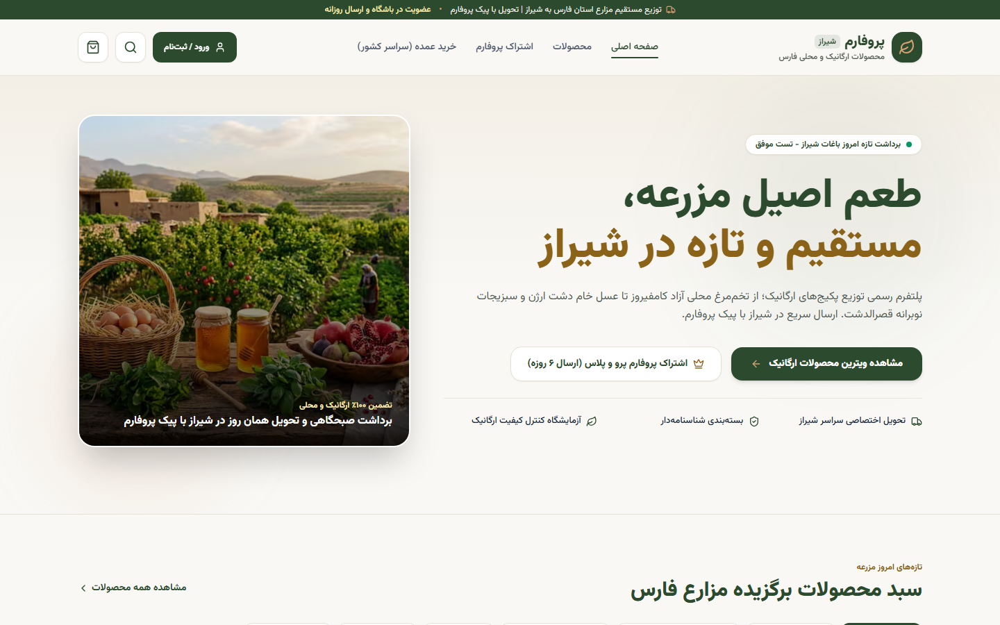
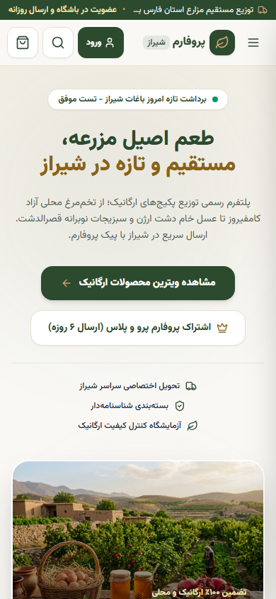

# Profarm Shiraz: Organic Food E-commerce Platform

**Live site: [profarm-shiraz.netlify.app](https://profarm-shiraz.netlify.app)** (Persian, right-to-left)

A full e-commerce platform for an organic farm-to-door food business in Shiraz, Iran. I built it end to end: storefront, checkout and payments, subscriptions, delivery scheduling, a full admin panel, and a native Android app for the admin team.



## Highlights

- **Full shopping flow**: catalogue with search and filters, cart, checkout, order tracking, returns and product reviews
- **Online payments** through the Zarinpal and SnappPay gateways, with a signed mock gateway for development
- **Subscription memberships** (Pro and Plus tiers) with member pricing, extra delivery days and monthly quotas
- **Delivery time slots** with capacity limits and order locking to prevent double booking
- **Login with SMS one-time codes**, email verification, and PBKDF2-hashed passwords (210k iterations) with signed session tokens
- **SMS and email notifications** for orders, plus admin-managed message templates and broadcasts
- **Admin panel**: orders, products, delivery manifest for drivers, finance reports, coupons, bulk B2B enquiries, returns, reviews, users, subscriptions, payment settings, SMS, and a live content editor
- **Native Android admin app** in Kotlin and Jetpack Compose
- **Automatic SEO**: Persian and English URL slugs, metadata and JSON-LD structured data
- **Security audit done**: fixed an OTP account-takeover path, a payment bypass and data leaks; every admin API re-checks the user's role ([audit summary](e2e/reports/SUMMARY.md))
- **167 Playwright end-to-end tests** across 7 customer and admin personas, including an adversarial one

| Product catalogue | Membership plans | Mobile |
|---|---|---|
|  |  |  |

## Tech stack

| Area | Tools |
|---|---|
| Framework | Next.js 16 (App Router, Server Components), React 19, TypeScript |
| Styling and UI | Tailwind CSS 4, Framer Motion, Lucide icons |
| State and forms | Zustand, React Hook Form, Zod |
| Data | PostgreSQL with Prisma, plus a file-backed store with atomic writes for local development |
| Payments and messaging | Zarinpal, SnappPay, SMS provider API, Nodemailer |
| Android | Kotlin, Jetpack Compose |
| Testing | Playwright |
| Hosting | Docker and Nginx, or Netlify |

## Project structure

```text
src/
  app/              storefront pages, account area, admin panel, API routes
  components/       UI components
  lib/              pricing, payments, subscriptions, sessions, SMS, data store
prisma/             database schema and seed script
profarm-admin-app/  Android admin app (Kotlin, Jetpack Compose)
e2e/                Playwright tests and audit reports
deploy/             Nginx config
```

## Run it locally

```bash
npm install
cp .env.example .env
npm run dev          # http://localhost:3000
```

Optional PostgreSQL: `npm run db:start` starts a local database, then `npm run db:push` and `npm run db:seed`.

Run the tests with `npm run test:e2e`. To run with Docker: set `POSTGRES_PASSWORD` in `.env`, then `docker compose up`.

More detail: [architecture guide](docs/ARCHITECTURE.md) (Persian)

## Author

Built by **Ali Hosseini**, full-stack developer. [LinkedIn](https://www.linkedin.com/in/ali-hosseini-dev/) · [GitHub](https://github.com/Ali-Black-Eagle)
